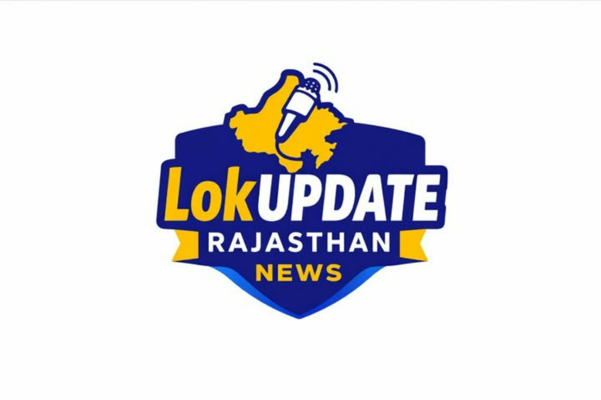

# LOKUPDATE RAJASTHAN - NEWS CREATIVE STUDIO
> **Official Instagram News Poster Designing Studio for LokUpdate Rajasthan**



## 📌 Features Overview

1. **Brand Identity & Official Logo**
   - Incorporates your official **LokUpdate Rajasthan News** logo with full proportions and quality preserved (`assets/lokupdate-logo-transparent.png` and `assets/lokupdate-logo.png`).
   - Integrated Brand Settings where you can toggle the logo, adjust size/position, change brand colors (`#17237F` Navy Blue, `#FFC400` Yellow, `#FFFFFF` White), and update social handles (`@lokupdaterajasthan`).

2. **Canva-Like Interactive Live News Editor**
   - **Interactive Elements**: Drag, reposition, scale with 8 bounding-box handles, and rotate elements freely.
   - **Layer Management**: Bring to front, send to back, move up/down, duplicate (`Ctrl+D`), and delete (`Delete`/`Backspace`).
   - **Snapping Guides**: Automatic alignment snap guides for centering horizontally and vertically.
   - **Undo / Redo**: 40-step history tracking (`Ctrl+Z`, `Ctrl+Y`).
   - **Zoom Controls**: Fit to Screen, 25% to 200% zoom controls.

3. **Multi-Size Instagram Presets**
   - **Instagram Square**: 1080 × 1080 px (1:1)
   - **Instagram Portrait**: 1080 × 1350 px (4:5)
   - **Instagram Story / Reel**: 1080 × 1920 px (9:16)
   - **Custom Dimensions**: Enter any custom width & height.

4. **Hindi & English Typography**
   - Google Fonts loaded: `Rozha One` (High-impact Hindi display), `Noto Sans Devanagari`, `Poppins`, `Rajdhani`, `Mukta`, `Yatra One`, `Hind`, `Bebas Neue`, `Inter`, `Montserrat`.
   - Full control over font size, weight, line-height, text color, alignment, and background highlight pill.

5. **7 Pre-Built News Templates + Custom Templates**
   - **Template 1**: Breaking News (*बड़ी खबर* - Dark navy backdrop, yellow highlights, live pulse badge, photo frame, news ticker)
   - **Template 2**: Rajasthan News (*राजस्थान न्यूज़* - Official state news bulletin format, dual-tone navy & gold header)
   - **Template 3**: Jaipur Local News (*जयपुर लोकल न्यूज़* - Urban news format with large photo & location pill)
   - **Template 4**: Politics News (*राजनीति हलचल* - Editorial layout with portrait space & quote styling)
   - **Template 5**: Education News (*शिक्षा एवं भर्ती अपडेट* - REET/Exam/results notification format)
   - **Template 6**: Sports News (*खेल समाचार* - High-energy dynamic sports highlight layout)
   - **Template 7**: Weather News (*मौसम अलर्ट* - IMD radar & temperature advisory bulletin)
   - **Custom Templates**: Save any design you create as a reusable custom template with 1 click.

6. **Image Upload & Multiple Photos**
   - Drag & drop images directly onto the canvas or into the sidebar upload dropzone.
   - Supports JPG, JPEG, PNG, WEBP.
   - Fit modes: Cover, Contain, Stretch. Corner radius and border controls.
   - Replace image without losing position or dimensions.

7. **Save & Export**
   - **Save Designs**: Save unlimited posters locally in IndexedDB / LocalStorage with instant visual preview thumbnails.
   - **Export & Download**: Full-resolution PNG or JPG download (pure poster without editor UI).
   - **Export History**: View previously downloaded posts with quick re-download links.

---

## 🚀 How to Run

1. Simply double-click **`start-studio.bat`** or run:
   ```bash
   python -m http.server 3000
   ```
2. Open your browser to:
   ```
   http://localhost:3000
   ```
